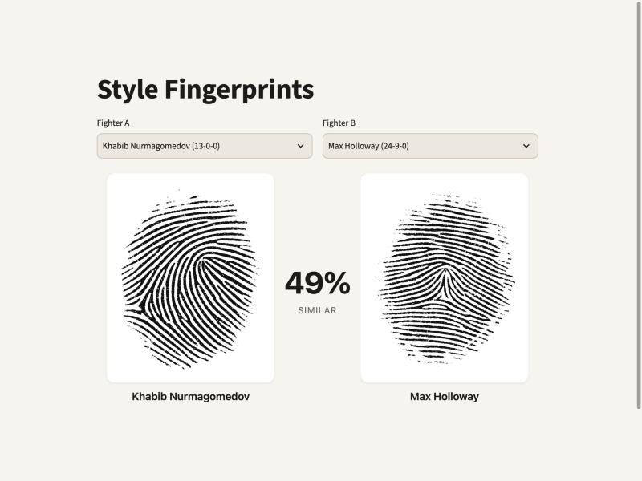

# UFC Style Fingerprints

**A data pipeline that turns every UFC fighter's career into a generated fingerprint.**

It ingests the full UFC stats history (798 events, 9,000+ fights, 42,000+ fighter-rounds), cleans and models it with tested dbt layers, resolves who's who across files that only name fighters, and publishes a data contract that a web page renders into a realistic inked fingerprint. Every ridge on the print traces back to a row in the database.



*Khabib (Wrestler, loop pattern, no KO losses so no creases) vs Max Holloway (Brawler, tented arch, one crease).*

---

## Run it

Requires Docker (OrbStack or Docker Desktop).

```bash
docker compose up -d --build
```

Then:

1. Open Dagster at http://localhost:3000 and materialize all assets (or run `docker compose exec dagster dagster asset materialize --select '*' -m ufc.orchestration.definitions`). The first load takes about a minute.
2. Open the app at http://localhost:8501 and pick any two fighters.

The pipeline then refreshes itself every Sunday at 10:00 (Toronto time), after Saturday-night events.

## How the pipeline works

```mermaid
flowchart LR
    GH["GitHub: community extract<br/>6 CSVs, refreshed every few days"] -->|download + retries| RAW["raw.file_snapshots<br/>every version, immutable"]
    RAW -->|header contract<br/>shrink guard| SRC["src.* (6 tables)<br/>latest version, all text"]
    SRC -->|identity resolution| ID["src.fighter_identity<br/>name in a fight → fighter_id"]
    SRC --> STG
    ID --> STG["dbt staging<br/>typed, deduped, parsed"]
    STG --> INT["dbt intermediate<br/>one row per fighter per fight"]
    INT --> MARTS["dbt marts<br/>career stats, archetypes,<br/>print contract"]
    MARTS --> APP["Streamlit page<br/>renders the fingerprint"]
```



| Stage | What it does | Why it matters |
|---|---|---|
| **Download** | Fetches the 6 CSVs and the upstream commit SHA. Retries 3× with exponential backoff. | A flaky network doesn't fail the run. |
| **Snapshots** | Stores each *distinct* version of each file (by SHA-256). Re-fetching unchanged data is a no-op. | Full history, idempotent reruns, and the raw data can always be reprocessed. |
| **Header contract** | Each file has an exact expected column list. A renamed or missing column fails loudly. | Upstream schema changes are caught instead of loading garbage. |
| **Shrink guard** | Refuses a file with fewer than 90% of the previous load's rows. The old table stays in place. | A truncated or broken upstream file can't wipe good data. |
| **Identity resolution** | Matches every "name in a fight" to a fighter ID (details below). | The stats files have **no fighter IDs**, and some names are shared. |
| **dbt staging** | Trims text, turns `--`/`---`/empty into NULL, splits `"11 of 25"`, converts `"3:45"` to seconds, dedupes fights listed under two event names, computes elapsed fight time from formats like `5 Rnd (5-5-5-5-5)`. | Messy text becomes typed, trustworthy columns. |
| **dbt marts** | Career rates (per minute / per 15 min), accuracy and defense, finish rate, rule-based style archetypes, and the renderer contract. | One clean, tested data product for the app. |
| **Checks** | 31 dbt data tests (keys, landed ≤ attempted, 2 fighters per fight, strike splits add up, unresolved-name rate, data freshness), 5 dbt unit tests on the parsing logic, and a Dagster freshness check on the upstream repo. | Problems show up as failed or warning checks, not as wrong charts. |

### Identity resolution

The stats files name fighters but don't identify them, and names collide: there are two Bruno Silvas (a 125 lb flyweight and a 185 lb middleweight). Each appearance is resolved in order:

1. **Exact name.** If several fighters share it, pick the one whose weight matches the bout's division, then the one of fighting age on the event date.
2. **Manual aliases** for nicknames rules can't guess (`"Patricio Pitbull"` → Patricio Freire), in [`aliases.csv`](src/ufc/identity/aliases.csv).
3. **Normalized name:** accents, hyphens and suffixes removed (`"Kai Kamaka III"` → `"kai kamaka"`).
4. **Fuzzy match** (≥ 92 similarity) within the same weight class (`"Rafael Cerquiera"` → Rafael Cerqueira).
5. Otherwise **unresolved**: recorded, warned about, and excluded from fingerprints.

Results on the real data (18,030 fighter appearances):

| exact | exact + weight | exact + age | alias | normalized | fuzzy | unresolved |
|---:|---:|---:|---:|---:|---:|---:|
| 17,917 | 50 | 1 | 22 | 26 | 4 | **10 (0.06%)** |

The 10 unresolved appearances belong to fighters missing from the upstream fighter list.

## How to read a print

Each fighter's print is grown live in the browser: a ridge-direction field (the Sherlock-Monro model from fingerprint science) is filtered with oriented Gabor filters until ridges form out of seeded noise, then "inked". Every visual feature comes from the data:

| What you see | What drives it |
|---|---|
| Pattern type | Style archetype: Striker = whorl, Wrestler = loop, Grappler = double loop, Brawler = tented arch, Balanced = plain arch |
| Ridge spacing | Pace: significant strikes landed per minute (busier = tighter) |
| Ink pressure | Finish rate (finishers leave bold prints) |
| Worn, broken ridges | Significant strikes absorbed per minute |
| Creases | One per KO/TKO loss |
| Ridge marks | One per UFC fight, spiralling out from the core like tree rings |
| Left or right hand | Stance: southpaws leave a mirrored left-hand print |
| Core height | Share of strikes aimed at the head |
| Print size | Reach |
| Fine details | Seeded from the fighter's ID: deterministic and unique |

Missing reach or stance (common for early-era fighters) falls back to a flagged default, so a print never fails.

## Project layout

```
src/ufc/ingest/         download, snapshots, header contract, shrink guard, load
src/ufc/identity/       fighter identity resolution + aliases
src/ufc/orchestration/  Dagster assets, freshness check, weekly schedule
src/ufc/cli.py          run without Dagster: python -m ufc.cli all
dbt/                    staging → intermediate → marts, unit tests and data tests
app/                    Streamlit page + the fingerprint renderer (JavaScript)
tests/                  pytest suite with fixture CSVs that reproduce every real quirk
docs/superpowers/       design spec and implementation plan
```

## Tests

```bash
docker compose up -d postgres
uv run pytest
node --test 'app/components/fingerprint/*.test.mjs'
```

The pytest suite runs the real loaders, identity resolution and the full dbt build against small fixture CSVs that reproduce the upstream quirks: duplicate names, misspellings, a fight listed under two events, blank rows, decimal-formatted counts and missing reach or stance.

## Data and credits

- Fight data comes from [UFCStats.com](http://ufcstats.com), via the community extract [Greco1899/scrape_ufc_stats](https://github.com/Greco1899/scrape_ufc_stats) (GPL-3.0).
- **Why not scrape UFCStats directly?** The site now serves a bot check to automated clients. This project respects that and consumes a published extract instead, which is also how data usually moves between teams: one system exports, another loads, validates and models it.
- No data is committed to this repo; the pipeline downloads it.
